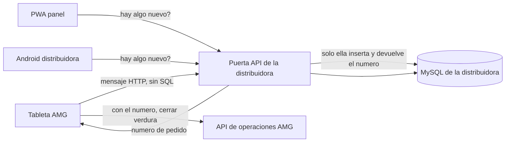
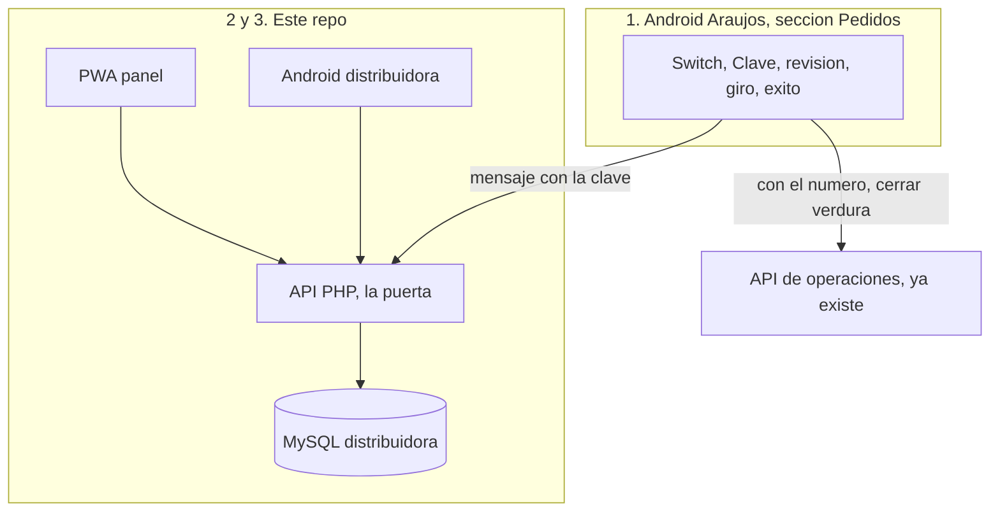

# Demo: Distribuidora de Productos

**Fecha:** 6 de octubre de 2026

Propuesta para mostrar, en vivo, que el pedido de verdura sale de la tableta de AMG y llega a un sistema de la distribuidora. No es el producto final.

La tableta de AMG manda un mensaje a la puerta de la distribuidora. Esa API es la única que inserta en su base. La PWA (panel) y la Android nueva leen por esa misma puerta, avisan, y la Android imprime los labels.

## Cómo lo estoy entendiendo

El pedido de verdura se arma igual que hoy en la app Android de AMG (Label DoorDash), en `PedidosScreen.kt` del proyecto Android AMG. Después de elegir el nombre, el encabezado ya tiene logo, la palabra Pedidos y un hueco a la derecha (`trailing` en `AppUtilityHeader.kt`). Ahí va un switch con la misma forma que el Training | Live del KDS (`KdsModeSwitch.tsx`): una palabra, la pastilla, la otra palabra. La palabra activa se ve fuerte; la otra, apagada.

Las dos palabras son **Local** y **Envío**.

- **Local** (apagado, el de todos los días): Cerrar verdura sigue con el diálogo que ya existe (`pedidos_close_confirm`). Bodega y carnes no cambian nunca.
- **Envío** (el de la reunión): el pedido de verdura se arma igual. Arriba, sutil, aparece el campo Clave. Al tocar Cerrar verdura no sale ese diálogo. Sale una pantalla blanca, sola, con el pedido para revisar (cantidad, unidad, producto), la fecha en que lo esperan (Hoy o Mañana) y dos botones: **Cancelar** a la izquierda y **Enviar pedido** a la derecha. El mensaje lleva la clave que está en ese campo.

Cancelar regresa al tablero. No cierra la verdura y no manda nada.

Enviar pedido manda un mensaje y se queda esperando. No abre la base de la distribuidora ni escribe en ella. La puerta responde con el número de pedido. Con ese número, la tableta cierra la verdura en AMG con el `cerrar` que ya existe y muestra la pantalla de éxito. Si la puerta no contesta, no hay número, no se cierra la verdura y se puede reintentar.

La PWA es el panel de control: pregunta a su propia puerta si hay pedido nuevo y lo muestra en el inbox. La Android de la distribuidora hace la misma pregunta, avisa en la barra y en la lista. Abrir el pedido muestra la tabla. Desde la Android se imprimen los labels.

El switch se guarda en la tableta de Pedidos donde se enciende. Por defecto queda en Local. Las demás tabletas siguen en Local y cierran la verdura como hoy. El Training | Live del KDS sí se guarda en su servidor y por eso cambia todas las pantallas; este switch no se escribe en la base de operaciones.

## Qué cambia en la Android de Araujos

Solo la sección Pedidos de Android AMG. El resto de Label DoorDash no se toca.

- En el encabezado del tablero (después de elegir quién pide): switch **Local | Envío**, esquina superior derecha. Misma pastilla que el KDS (Training a la izquierda en ámbar, Live a la derecha en verde). Aquí Local a la izquierda, Envío a la derecha.
- Preferencia en el aparato, default Local. La clave también se guarda en la tableta.
- Con el switch en Envío, justo bajo el encabezado, una franja sutil: la palabra Clave, el valor, y un botón pequeño de editar. El campo nace bloqueado. Editar lo abre para pegar la llave que mostró el panel al crear la cuenta; al terminar vuelve a quedar bloqueado. En Local esa franja no se ve.
- Si el switch está en Envío y el tipo a cerrar es verdura: pantalla blanca de revisión en lugar del diálogo actual de cerrar. Incluye las líneas pedidas, selector Hoy / Mañana, Cancelar y Enviar pedido.
- Al tocar Enviar pedido, esa pantalla pasa a una de procesamiento. En el centro, el indicador circular de «procesando»: el arco dando vueltas sobre su eje, no un círculo quieto. Sigue girando mientras el mensaje viaja y la tableta espera la respuesta. El mensaje lleva la clave del campo, las líneas (cantidad, unidad, nombre), quién cerró y la fecha esperada. La tableta no tiene clave de MySQL de la distribuidora.
- La respuesta de la puerta es el número de pedido. Cuando llega, el giro se detiene, se llama `OpsPedidosApi.cerrar("verdura", ...)` y se muestra el éxito: la orden ya fue puesta, el número de su pedido, y un gracias breve. Si la clave está vacía, la puerta no la reconoce o no hay respuesta, el giro se detiene, no hay número, no se cierra la verdura y se puede volver a enviar.
- Bodega, carnes y el modo Local siguen el diálogo y el `cerrar` de hoy.

## Qué lleva la aplicación nueva

Sigue el corte de Operaciones AMG, en este repo:

- `insumos/planes/` — este plan.
- `app/` — PWA, panel de control. Crear cuenta, inbox tipo mensaje, aviso de pedido nuevo, detalle en tabla, vista previa del label.
- `api/` — PHP. Esta es la puerta. Recibe el mensaje, busca la llave, y solo si es de un cliente suyo inserta el pedido a nombre de ese cliente. También responde cuando el panel o la Android preguntan si hay algo nuevo.
- `database/` — clientes (cada uno con su llave secreta), direcciones, pedidos, líneas. En el demo la cuenta no viene sembrada: se crea desde el panel y el inbox arranca vacío. El pedido aparece al tocar Enviar pedido.
- `android/` — app nueva. Consulta la API; cuando entra una fila, notificación en la barra y en la lista. Abrir muestra la tabla. Imprimir manda un label por unidad, `ceil(cantidad)`, 4 × 2.5 in, ZPL a 203 dpi, por Bluetooth.
- `apk/` — copia fija de esa APK, lista para subir al servidor. Gradle la reemplaza en cada build.

Labels: 10 cajas de aguacate = 10 (`1 de 10` … `10 de 10`). 3 de habanero = 3. 0.5 de pimentón = 1 (`1 de 1`). Libras, bolsas y piezas igual, redondeando hacia arriba. La secuencia es por producto. En cada label: logo «Distribuidora de Productos», número de pedido, fecha de impresión, cliente, dirección, producto y `n de N`.

El primer demo corre en esta máquina: MySQL nuevo en XAMPP, PHP y la PWA en local. La tableta y el teléfono llegan a esa puerta por la IP de la red local. El aviso es la PWA y la Android preguntándole a esa puerta cada pocos segundos si hay un pedido nuevo.

## La puerta

Hay dos casas y dos bases. No se comparten.

Cada cliente de la distribuidora tiene su propia llave. No es una clave única de la puerta. En el panel, Crear cuenta pide nombre y dirección. Al guardarla, la puerta genera la llave secreta, la guarda en esa ficha y la muestra en pantalla para copiarla. Esa es la que se pega en el campo Clave de la tableta.

La tableta entrega un JSON por HTTP a la URL de la puerta. Dentro del mensaje va la clave del campo, junto con el pedido. Ahí se acaba su trabajo con la distribuidora. No inserta filas, no conoce el usuario de MySQL, no abre su base.

La puerta es `api/` de la distribuidora, el respaldo de la PWA y de la Android nueva. Es quien escucha. Busca la llave entre sus clientes. Si no está, no guarda nada. Si está, ya sabe de qué cliente es el mensaje, toma la dirección de esa ficha, ella hace el INSERT a nombre de ese cliente y genera el número de pedido. Esa respuesta es el regreso: el número. La tableta no da por buena la orden antes de recibirlo. Otro restaurante, el día que tenga cuenta, manda otra llave y el pedido cae en su ficha, no en la de Araujos.

El panel y la Android de la distribuidora no reciben el mensaje de la tableta. Le preguntan a su propia puerta si hay algo nuevo. La puerta lee lo que ella misma guardó y se los da. Por eso el pedido aparece en las dos a la vez: las dos miran el mismo lugar, y ese lugar solo lo escribe la distribuidora.

Cuando la puerta ya respondió con el número, la tableta cierra la verdura en la API de operaciones de AMG, que es otra casa.

## Diseño del demo

La app de Araujos se queda con su cara actual. La pantalla blanca de revisión es limpia y con botones grandes, sin rehacer Label DoorDash. El verde y los iconos son de la distribuidora.

Base vegetal, distinta del verde de botón que ya usa la verdura en AMG (`#15803D`).

- Hoja `#1F6B3A` para encabezado y el botón principal.
- Fondo `#E7F3EA`, fichas blancas, tinta `#14241A`.
- «Para hoy» en hoja. «Para mañana» en contorno. «Nuevo» en ámbar `#C4A035`, para que no se pierda dentro del verde.

Android de la distribuidora, una acción grande por pantalla, filas de al menos 88 dp y el botón principal a 64 dp:

- Inbox. Cada pedido es una fila: nombre del cliente grande, número y hora, y a la derecha si es para hoy o para mañana. Lo nuevo lleva campana.
- Detalle. Arriba, cliente, dirección y fecha esperada. Abajo, tabla de tres columnas: cantidad grande, unidad, producto.
- Un botón fijo abajo: Imprimir labels. De ahí sale un label por unidad, `ceil(cantidad)`, 4 × 2.5 in.

PWA, el panel en la laptop: la misma lista a la izquierda y el detalle a la derecha, más un aviso arriba cuando entra un pedido mientras la pantalla está abierta. La vista previa del label vive aquí. La impresión Bluetooth vive en la Android, que es la que tiene la Zebra.

Iconos Heroicons outline, los mismos dibujos en las dos. En la PWA, `@heroicons/react/24/outline`. En la Android, esos SVG como vectores, no otra familia.

- Inbox y pedido: `InboxIcon`, `ChatBubbleLeftRightIcon`
- Aviso: `BellIcon`
- Cliente, dirección, fecha: `UserIcon`, `MapPinIcon`, `CalendarDaysIcon`
- Línea de producto: `CubeIcon`
- Imprimir: `PrinterIcon`
- Recibido: `CheckCircleIcon`

## Cómo se implementa

Son tres partes. La base de operaciones de AMG no se toca. `pedidos_tablet.php` sigue cerrando la verdura como hoy. Lo nuevo habla con otra base, `distribuidora`, en este repo.

El orden es la puerta primero, luego el panel, luego la tableta de Araujos, luego la Android nueva. Sin la puerta, las otras dos no tienen a quién hablarle. Base, API y panel nacen aquí, en local, en una base nueva. La APK también se genera en este corte: cada build la deja en `apk/` para subirla cuando haga falta.

### 1. PWA de la distribuidora, con su puerta

En este repo, el mismo corte que Operaciones AMG: `app/` Astro 4, React 18, Tailwind 3, `@vite-pwa/astro` y `@heroicons/react`. `api/` en PHP. `database/` en MySQL por XAMPP, base nueva `distribuidora`, distinta de `operaciones_amg`. `apk/` al lado, vacía hasta el primer build.

Tablas:

- `clientes`: nombre, dirección y `llave` única.
- `pedidos`: número (el id que devuelve el INSERT), cliente, fecha esperada, quién cerró, recibido_en.
- `pedido_lineas`: cantidad, unidad, nombre.

La puerta, al estilo de `pedidos_tablet.php`: un PHP por acción, JSON adentro y JSON afuera.

- `POST` crear cuenta. El panel manda nombre y dirección. PHP genera la llave, la guarda en `clientes` y la regresa para mostrarla.
- `POST` mensaje. La tableta manda la clave, la fecha esperada, quién cerró y las líneas. PHP busca la llave. Si no está, responde error y no inserta. Si está, inserta pedido y líneas en una transacción y responde `{ numero }`.
- `GET` pedidos. El panel y la Android nueva preguntan la lista. La respuesta no incluye las llaves.

La PWA tiene Crear cuenta (ahí se ve la llave), el inbox a la izquierda y el detalle a la derecha. Pregunta el `GET` cada pocos segundos. Si aparece un id nuevo, muestra el aviso con `BellIcon`. La vista previa del label se arma en el navegador con la misma regla `ceil(cantidad)`.

En local, el PHP del panel puede quedar en `127.0.0.1`. Para que la tableta de Araujos y el teléfono de la distribuidora hablen con esa misma puerta, el PHP también escucha en la IP de la red.

### 2. Android de la distribuidora

Proyecto nuevo en `android/` de este repo. Kotlin y Compose, `minSdk` 26, como Android AMG. Paquete propio. No vive dentro de Label DoorDash.

Pantallas: inbox, detalle, botón Imprimir labels. Heroicons outline como vectores en `res/drawable`, los mismos nombres que en la PWA. Filas de 88 dp, botón de 64 dp, colores hoja `#1F6B3A` y fondo `#E7F3EA`.

Mientras la app está abierta, un ciclo corto hace el mismo `GET` de pedidos. Si entra un id que no estaba, se agrega la fila y se publica una notificación en la barra. Abrirla lleva al detalle.

Imprimir recorre cada línea, saca `ceil(cantidad)` copias y arma ZPL de 4 × 2.5 a 203 dpi (`^PW812`, `^LL508`), con el contenido de la distribuidora. Sale por Bluetooth. El renderer de DoorDash de AMG no se modifica.

Al compilar, Gradle deja el APK en la salida normal de Android y lo copia a `apk/Distribuidora.apk`, nombre fijo, reemplazando el anterior. Esa carpeta es la que se sube por FTP. El binario no se commitea. La APK de Araujos sigue copiándose donde ya se copia, `Operaciones AMG/apk/LabelDordash.apk`.

### 3. Pedidos en la Android de Araujos

Solo `PedidosScreen.kt` y archivos nuevos al lado, en `ui/pedidos` y `data`. El encabezado ya tiene `trailing`: ahí entra el switch Local | Envío. Modo y clave se guardan en la tableta con `SharedPreferences`.

Con Envío activo, bajo el encabezado va la franja Clave, bloqueada, con el botón de editar. En Local no se dibuja.

El diálogo de cerrar se queda para bodega, carnes y verdura en Local. Si el tipo es verdura y el modo es Envío, en vez del diálogo se abre la revisión blanca. Enviar pedido cambia a una pantalla con `CircularProgressIndicator` girando y un cliente HTTP nuevo, hermano de `OpsPedidosApi.kt`, apuntando a la URL de la distribuidora. Arma el JSON con la clave del campo y las líneas de verdura ya pedidas.

Si la respuesta trae `numero`, se llama `OpsPedidosApi.cerrar("verdura", ...)` y el giro da paso al texto de éxito con ese número. Si no hay número, el giro se detiene, la verdura sigue abierta y se puede reintentar.

## Qué duele, en una frase

Hoy el cierre de verdura se comparte por WhatsApp y puede quedarse en un solo celular. El demo enseña el mismo pedido saliendo de la tableta y cayendo en un panel que ven los dos dueños, con la fecha en que se espera y un label por caja.

Lo que el ramo también vende y este corte no construye: faltantes, rutas, precios del día, factura e inventario. Se nombra en la reunión.

## Fuera de este corte

- Portal para que otros restaurantes pidan solos.
- Precios, factura, inventario, rutas, faltantes y sustituciones.
- La tableta de AMG escribiendo en la base de la distribuidora.
- Push Firebase.
- Cambiar el cierre de bodega o de carnes.
- Compartir el switch Local | Envío entre todas las tabletas guardándolo en la base de operaciones. En este demo vive solo en la tableta de Pedidos.
